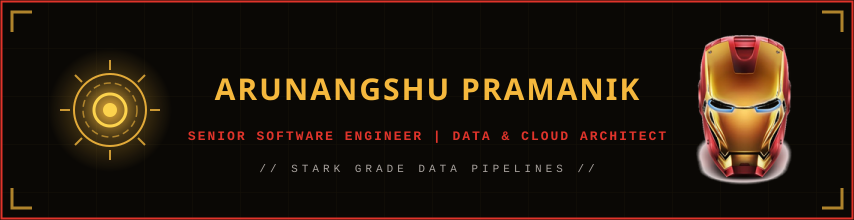

  

 
  

  

## Senior Software Engineer | Data & Cloud Services Architect | Python, Azure & GCP Enthusiast

Welcome to my GitHub profile! I'm Arunangshu Pramanik, a Senior Software Engineer with 7+ years of experience architecting data and cloud solutions across Azure and GCP. I have a proven track record of designing and delivering production-grade data pipelines, SaaS products, and AI-powered tooling - from BigQuery and Airflow ingestion frameworks to AI agents and data-catalog chatbots.

### About Me

- 📍 **Location:** Bangalore, Karnataka, India
- 📧 **Email:** arunangshu01@gmail.com
- 🌐 [**Portfolio**](https://arunangshu-pramanik-portfolio.web.app/)
- 🔗 [**LinkedIn**](https://www.linkedin.com/in/arunangshu-pramanik-1896168b/) | [**GitHub**](https://github.com/arunangshu01) | [**LeetCode**](https://leetcode.com/u/arunangshu01)

### Experience

- **Senior Software Engineer** - Impact Analytics, Bangalore *(Dec 2024 - Present)*
  - Building core data engineering pipelines (Airflow + GCP) powering AI-driven retail products for clients like Ralph Lauren, Swarovski, Gap, Foot Locker, Patagonia, and Levi's
  - Architected a near real-time integration framework using Cloud SQL, Cloud Run Functions, Cloud Tasks, BigQuery, Workflows, Eventarc, and PostgreSQL
  - Built AI agents and chatbots for pipeline triage, task generation, and a Databricks/Snowflake-style data-catalog assistant
- **Digital Engineering Lead Engineer** - Apisero Inc. (now NTT Data), Bangalore *(Aug 2021 - Dec 2024)*
  - Developed a SaaS application on Azure Event Hubs, ELK Stack, Snowflake, Blob Storage, and Python for Blue Yonder
  - Delivered real-time data pipeline solutions to a dozen+ customers including JCPenney, ASDA, 7-Eleven, CVS, Heineken, and Walmart
- **Systems Engineer** - Infosys Limited, Bangalore *(Oct 2019 - Jul 2021)*
  - Designed and managed software programs for Cisco Systems across front-end and back-end stacks

### Skills

- **Programming Languages:** Python, SQL, Java, JavaScript, TypeScript
- **Databases & Data Warehouses:** MSSQL, Oracle, PostgreSQL, Snowflake, Databricks, BigQuery
- **Data Analysis:** Pandas, NumPy, PySpark
- **Frameworks:** FastAPI, Django, Spring Boot, RESTful APIs
- **Cloud Platforms:** Azure, GCP
- **Orchestration:** Apache Airflow
- **Others:** 
  - **Azure:** Event Hubs, Files, Blob Storage, Container Registry & Services, Key Vault, Storage Explorer
  - **GCP:** Cloud Tasks, Cloud Run (Functions), Cloud SQL, Cloud Scheduler, Workflows, Eventarc, Cloud Storage, Secret Manager, Pub/Sub, Dataflow, Compute Engine, Analytics Hub, IAM, VPC, Google Cloud APIs, Databricks Workspace
  - **DevOps:** Docker, Kubernetes, Jenkins, Git, GitHub Actions, Bitbucket Pipelines, Shell Scripting, YAML
  - **Monitoring & Logging:** Datadog, Elasticsearch, Kibana
  - **Messaging & Caching:** Kafka, Redis
  - **Development & Collaboration:** Jira, Confluence, Slack, DBeaver, Postman, Offset Explorer
  - **AI Tools:** Cursor, Devin AI
  - **Web Development:** HTML, CSS, Bootstrap, Angular, React

### Education

- **Bachelor of Technology (B.Tech) in Computer Science & Engineering (CSE)**
  - Institute of Engineering & Management (IEM), Kolkata
  - Graduated with an 8.53 GPA in 2019

### Awards & Recognitions

- **Cisco Systems: Most Valuable Player of the Quarter** - Infosys Limited (March 2020)
- **Rookie of the Quarter** - Apisero Inc. (October 2021)
- **Apisero Aces Award** - Apisero Inc. (October 2022)
- **5 x Raving Reviews Awards** - Apisero Inc. (October 2021, December 2021, March 2022, January 2023 & February 2023)
- **Vendustrious Award** - Apisero Inc. (March 2023)
- **Impact Excellence Award - Q2 2026** - Impact Analytics (June 2026)

### GitHub Statistics

 
   

  

  

  

### Holopin Board

### Snake Generator Animation

  <picture>
    <source media="(prefers-color-scheme: dark)" srcset="https://raw.githubusercontent.com/arunangshu01/arunangshu01/output/github-snake-dark.svg" />
    <source media="(prefers-color-scheme: light)" srcset="https://raw.githubusercontent.com/arunangshu01/arunangshu01/output/github-snake.svg" />
    
  </picture>

### Artwork in Profile

  <picture>
    
  </picture>

### Let's Connect

I'm always open to connecting with like-minded professionals and exploring new opportunities. Whether you have a question, a project idea, or just want to chat about technology, feel free to reach out!

---

Thank you for visiting my GitHub profile. Happy coding! 🚀

---

_Arunangshu Pramanik_

---

  

  Fun Fact Of The Day

  

  

     

