<p align="center">
  
</p>

<p align="right"> 
  
</p>

<p align="center">
  <a href="https://arunangshu-pramanik-portfolio.web.app/">
    
  </a>
</p>

<p align="center">
  
</p>

## Senior Software Engineer | Data & Cloud Architect

Data platform engineer with **7+ years** of experience designing production-grade pipelines, event-driven SaaS systems, and AI-powered developer tooling across **Azure** and **GCP**.

```yaml
location:  Bangalore, Karnataka, India
focus:     Data Platforms, ETL/ELT Frameworks, Real-time Integration, AI Agents
cloud:     [GCP, Azure]
contact:   arunangshu01@gmail.com
```

<p align="center">
  📍 Bangalore, India &nbsp;·&nbsp;
  <a href="mailto:arunangshu01@gmail.com"> <b>Email</b></a> &nbsp;·&nbsp;
  <a href="https://arunangshu-pramanik-portfolio.web.app/"> <b>Portfolio</b></a> &nbsp;·&nbsp;
  <a href="https://www.linkedin.com/in/arunangshu-pramanik-1896168b/"> <b>LinkedIn</b></a> &nbsp;·&nbsp;
  <a href="https://github.com/arunangshu01"> <b>GitHub</b></a> &nbsp;·&nbsp;
  <a href="https://leetcode.com/u/arunangshu01"> <b>LeetCode</b></a>
</p>

> `SYS://J.A.R.V.I.S` - ALL SYSTEMS OPERATIONAL · SUIT INTEGRITY 100% · ARC REACTOR STABLE

<p align="center">
  
</p>

### Impact at a Glance

| | |
|---|---|
| **20+ enterprise clients** | Retail & FMCG pipelines for Ralph Lauren, Swarovski, Gap, Walmart, Heineken, CVS, 7-Eleven |
| **Billions of records** | ETL systems processing high-volume transactional data in production |
| **~90% efficiency gains** | Modernized standalone codebases and decoupled legacy systems |
| **Team leadership** | Led and mentored a pod of 3 engineers; ran design sessions and code reviews |

### What I Build

- **Data ingestion frameworks** - two-stage sourcing + ingestion pipelines (Airflow, BigQuery) that extract, validate, and transform client data into master entity tables consumed by AI products
- **Near real-time integration** - event-driven architectures on Cloud SQL, Cloud Run Functions, Cloud Tasks, Workflows, Eventarc, Pub/Sub, PostgreSQL
- **AI engineering tooling** - agents for connector-failure triage, chatbots for pipeline task generation, and a Databricks/Snowflake-style data-catalog assistant with SQL generation
- **Observability & FinOps** - cost and runtime dashboards for Cloud Run, Cloud Functions, and Compute Engine
- **SaaS platforms** - event-driven applications on Azure Event Hubs, ELK, and Snowflake

<p align="center">
  
</p>

### Experience

- **Senior Software Engineer** - Impact Analytics, Bangalore *(Dec 2024 - Present)*
  - Own core data engineering pipelines (Airflow + GCP) powering the AI-driven retail suite - PlanSmart, DemandSmart, InventorySmart, PriceSmart, PromoSmart, MarkSmart, DataSmart
  - Architected the near real-time ingestion & cancellation framework across Cloud SQL, Cloud Run Functions, Cloud Tasks, BigQuery, Workflows, Eventarc, and PostgreSQL
  - Built an AI agent for connector-failure triage and a data-catalog copilot over warehouses, workspaces, and BigQuery
  - Led and trained a team of 3 engineers; ran design sessions and reviewed deliverables
- **Digital Engineering Lead Engineer** - Apisero Inc. (now NTT Data), Bangalore *(Aug 2021 - Dec 2024)*
  - Developed a SaaS application on Azure Event Hubs, ELK Stack, Snowflake, and Python for Blue Yonder
  - Shipped real-time data pipelines to 12+ customers (JCPenney, ASDA, 7-Eleven, CVS, Heineken, Walmart); designed ETL systems processing billions of transactions
  - Achieved 90%+ code coverage via decoupling; authored configuration blueprints for data migration platforms
- **Systems Engineer** - Infosys Limited, Bangalore *(Oct 2019 - Jul 2021)*
  - Built and maintained full-stack programs and APIs for Cisco Systems; 95% QA efficiency

<p align="center">
  
</p>

### Technical Arsenal

| Domain | Stack |
|---|---|
| **Languages** | Python, SQL, Java, JavaScript, TypeScript |
| **Data & Warehouses** | BigQuery, Snowflake, Databricks, PostgreSQL, MSSQL, Oracle |
| **Processing** | Apache Airflow, Pandas, NumPy, PySpark, Dataflow |
| **GCP** | Cloud Run (Functions), Cloud Tasks, Cloud SQL, Cloud Scheduler, Workflows, Eventarc, Pub/Sub, Secret Manager, Analytics Hub, IAM, VPC |
| **Azure** | Event Hubs, Blob Storage, Files, Container Registry & Services, Key Vault |
| **APIs & Frameworks** | FastAPI, Django, Spring Boot, REST |
| **DevOps** | Docker, Kubernetes, Jenkins, GitHub Actions, Bitbucket Pipelines, Shell |
| **Observability** | Datadog, Elasticsearch, Kibana |
| **Messaging & Cache** | Kafka, Redis |
| **AI Tooling** | Cursor, Devin AI |
| **Web** | HTML, CSS, Bootstrap, Angular, React |

### Education

- **Bachelor of Technology in Computer Science & Engineering** - Institute of Engineering & Management (IEM), Kolkata *(2015 - 2019)*
  - Graduated with a DGPA of 8.53

<p align="center">
  
</p>

### Awards & Recognitions

- **Impact Excellence Award (Q2 2026)** - Impact Analytics (June 2026)
- **Apisero Aces Award** - Apisero Inc. (October 2022)
- **Vendustrious Award** - Apisero Inc. (March 2023)
- **Raving Reviews Awards x5** - Apisero Inc. (October 2021, December 2021, March 2022, January 2023 & February 2023)
- **Rookie of the Quarter** - Apisero Inc. (October 2021)
- **Most Valuable Player of the Quarter** - Cisco Systems, Infosys Limited (March 2020)

<p align="center">
  
</p>

### GitHub Statistics

<p align="center"> 
   
</p>

<p align="center">
  
</p>

<p align="center">
  
</p>

<p align="center">
  
</p>

<p align="center">
  
</p>

### Holopin Board

<p align="center">
  <a href="https://holopin.io/@arunangshu01">
    
  </a>
</p>

<p align="center">
  
</p>

### Snake Generator Animation

<p align="center">
  <picture>
    <source media="(prefers-color-scheme: dark)" srcset="https://raw.githubusercontent.com/arunangshu01/arunangshu01/output/github-snake-dark.svg" />
    <source media="(prefers-color-scheme: light)" srcset="https://raw.githubusercontent.com/arunangshu01/arunangshu01/output/github-snake.svg" />
    
  </picture>
</p>

<p align="center">
  
</p>

### Artwork in Profile

<p align="center">
  <picture>
    
  </picture>
</p>

<p align="center">
  
</p>

### Let's Connect

I'm always open to connecting with like-minded professionals and exploring new opportunities. Whether you have a question, a project idea, or just want to chat about technology, feel free to reach out via [LinkedIn](https://www.linkedin.com/in/arunangshu-pramanik-1896168b/), [email](mailto:arunangshu01@gmail.com), or my [portfolio](https://arunangshu-pramanik-portfolio.web.app/).

---

Thank you for visiting my GitHub profile. Happy coding! 🚀

_Arunangshu Pramanik_

---

### Fun Fact of the Day

<p align="center">
  
</p>
<p align="center">
  
</p>
<p align="center">
  
</p>

<p align="center">
  
</p>

